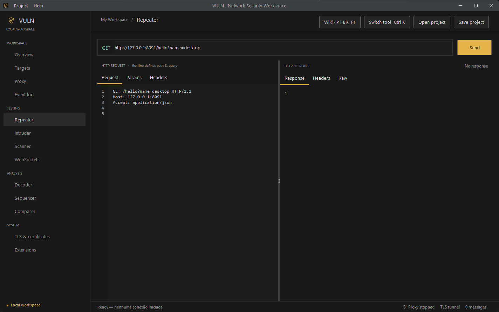

<div align="center">


# VULN

**Workbench desktop open source para testes de segurança em aplicações web.**
Proxy de interceptação, Repeater, Intruder, Scanner, WebSockets, Decoder e mais, em um app nativo para Windows.

[](LICENSE)
[](https://github.com/chiarorosa/vuln/releases/latest)

[**Download**](https://github.com/chiarorosa/vuln/releases/latest) · [English](README.md) · [Como contribuir](CONTRIBUTING.md) · [Roadmap](desktop/VULN-Roadmap.md)



</div>

## Por que usar o VULN

- **Livre e aberto.** GPL-3.0, sem chave de licença, sem telemetria e sem conta.
- **Nativo e offline.** Java/Swing com runtime embutido. Descompacte e abra `VULN.exe`.
- **Resultados honestos.** Só mostra tráfego real medido. Achados aparecem como evidência a avaliar, não como prova de vulnerabilidade.
- **Fácil de estender.** Código enxuto, API de extensões com um único método e testes de integração com servidores locais reais.

## Ferramentas

Proxy (interceptação HTTP/1.1 e HTTPS opcional com CA local), Repeater, Intruder (quatro modos), Scanner (crawl na mesma origem, checks passivos, relatório HTML), WebSockets, Target, Decoder, Sequencer, Comparer, TLS, Extensões, Projetos e uma **Wiki offline em pt-BR** com vinte artigos (`F1`).

A lista completa e o que já está no `main` aparecem no [README em inglês](README.md#features). As pendências estão no [roadmap](desktop/VULN-Roadmap.md).

## Começo rápido

1. Baixe `VULN-<versão>-windows-x64.zip` em [Releases](https://github.com/chiarorosa/vuln/releases/latest).
2. Descompacte e abra `VULN.exe`.
3. Abra **Overview → Start local test server**, volte ao **Repeater** e clique em **Send**. O servidor usa uma porta local disponível.

## Repeater

O campo URL define a origem. Método, caminho e query vêm da primeira linha do Request, que é editado em formato raw. Params e Headers são visualizações somente leitura. Envie com **Send** ou `Ctrl+Enter`.

Response mostra o corpo. JSON identificado pelo Content-Type ganha indentação e destaque de sintaxe (até 256 KiB). Raw preserva a resposta HTTP completa. Status, tempo e tamanho vêm do envio real.

## Compilar a partir do código

Requisitos: Windows, **JDK 21+** (`JAVA_HOME` configurado) e **Node.js 18+**.

```powershell
git clone https://github.com/chiarorosa/vuln.git
cd vuln\desktop
node setup-deps.mjs
node setup-workspace-deps.mjs
.\test.ps1          # build + suíte de integração (somente loopback)
.\package-vuln.ps1  # imagem Windows com runtime embutido
```

## Uso responsável

Use o VULN apenas em sistemas que são seus ou que você tem **autorização explícita** para testar. Para relatar falhas de segurança no próprio VULN, consulte [SECURITY.md](SECURITY.md).

## Licença

[GPL-3.0](LICENSE) © Pablo De Chiaro Rosa.
